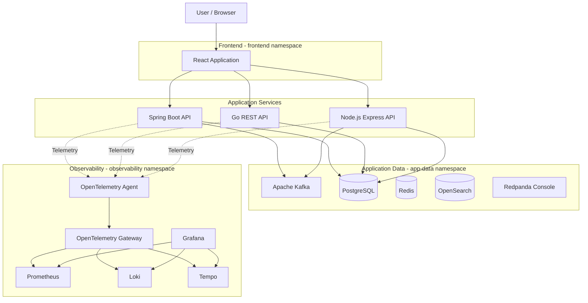

# Kubernetes-Native Observability Platform

A hands-on Kubernetes observability lab demonstrating how to instrument, collect, process, visualize, and troubleshoot telemetry across multiple applications and infrastructure components.

Built around the **OpenTelemetry + LGTM stack**, this project brings together distributed tracing, centralized logging, metrics, application monitoring, and Kubernetes infrastructure visibility.

The environment runs on Minikube and uses Helm and Kubernetes manifests to deploy the applications and observability infrastructure.

---

## Table of Contents

- [Overview](#overview)
- [Architecture](#architecture)
- [Technology Stack](#technology-stack)
- [Kubernetes Environment](#kubernetes-environment)
- [Prerequisites](#prerequisites)
- [1. Start Minikube](#1-start-minikube)
- [2. Install Headlamp](#2-install-headlamp)
- [3. Deploy Application Backing Services](#3-deploy-application-backing-services)
- [4. Deploy Applications](#4-deploy-applications)
- [5. Install OpenTelemetry Collectors](#5-install-opentelemetry-collectors)
- [6. Install the Observability Backend](#6-install-the-observability-backend)
- [7. Access the Observability Tools](#7-access-the-observability-tools)
- [8. Build and Push Application Images](#8-build-and-push-application-images)
- [9. Generate Application Load](#9-generate-application-load)
- [10. Explore Telemetry](#10-explore-telemetry)
- [Troubleshooting](#troubleshooting)
- [Useful Kubernetes Commands](#useful-kubernetes-commands)
- [Reference Projects](#reference-projects)

---

## Overview

This project demonstrates Kubernetes-native observability across a distributed application environment.

It includes:

- Multiple backend applications implemented in Java, Go, and Node.js.
- A React frontend that interacts with the backend services.
- Kafka-based asynchronous communication.
- PostgreSQL, Redis, and OpenSearch as application backing services.
- OpenTelemetry instrumentation and telemetry collection.
- Distributed tracing with Grafana Tempo.
- Centralized logging with Grafana Loki.
- Metrics collection and monitoring with Prometheus.
- Visualization and exploration using Grafana.
- Kubernetes cluster monitoring and management through Headlamp.

The objective is to understand how telemetry flows through a distributed application, from frontend interactions to backend APIs, messaging systems, and infrastructure components.

## Architecture

### High-level architecture



### OpenTelemetry collection pattern

The project uses two OpenTelemetry Collector deployment patterns:

**Agent**
- Deployed as a Kubernetes DaemonSet.
- Runs on Kubernetes nodes.
- Collects telemetry close to the workloads.

**Gateway**
- Deployed as a Kubernetes Deployment.
- Provides a centralized telemetry processing and export layer.
- Routes telemetry to the observability backends.

This separation provides a foundation for understanding scalable telemetry collection patterns in Kubernetes.

---

## Technology Stack

| Area | Technology |
|---|---|
| Container orchestration | Kubernetes |
| Local Kubernetes | Minikube |
| Package management | Helm |
| Kubernetes dashboard | Headlamp |
| Frontend | React |
| Java backend | Spring Boot |
| Go backend | Go |
| Node.js backend | Express |
| Messaging | Apache Kafka 4.0.0 |
| Relational database | PostgreSQL 17 |
| Cache | Redis |
| Search and indexing | OpenSearch |
| Kafka UI | Redpanda Console |
| Telemetry instrumentation | OpenTelemetry |
| Telemetry collection | OpenTelemetry Collector |
| Metrics | Prometheus |
| Logs | Grafana Loki |
| Traces | Grafana Tempo |
| Visualization | Grafana |
| Load testing | k6 |

---

## Kubernetes Environment

The project uses the following namespaces:

| Namespace | Responsibility |
|---|---|
| `headlamp` | Kubernetes management UI |
| `app-data` | Kafka, PostgreSQL, Redis, OpenSearch |
| `spring-app` | Spring Boot application |
| `go-app` | Go application |
| `node-app` | Node.js application |
| `frontend` | React frontend |
| `observability` | OpenTelemetry, Prometheus, Loki, Tempo, Grafana |

## Prerequisites

Install the following tools:

- Docker
- Minikube
- kubectl
- Helm 3
- Git
- Node.js and npm
- Java and Maven
- Go
- k6 (for load testing)

Check your installations:

```bash
docker --version
minikube version
kubectl version --client
helm version
node --version
npm --version
mvn --version
go version
```

---

## 1. Start Minikube

Start a three-node Minikube cluster using Docker as the driver.

```bash
minikube start \
  --driver=docker \
  --nodes=3 \
  --cpus=6 \
  --memory=12g \
  --kubernetes-version=v1.35.1
```

Verify the cluster:

```bash
minikube status
kubectl get nodes -o wide
kubectl get namespaces
```

---

## 2. Install Headlamp

Headlamp provides a graphical interface for inspecting and managing Kubernetes resources.

Add the Helm repository:

```bash
helm repo add headlamp https://kubernetes-sigs.github.io/headlamp/
helm repo update
```

Install Headlamp:

```bash
kubectl create namespace headlamp

helm install headlamp headlamp/headlamp \
  --namespace headlamp
```

Generate an authentication token:

```bash
kubectl create token headlamp --namespace headlamp
```

Expose the UI:

```bash
kubectl port-forward -n headlamp svc/headlamp 8080:80
```

Access:

**http://localhost:8080**

Use the generated token to log in.

---

## 3. Deploy Application Backing Services

The application backing services are deployed in the `app-data` namespace.

Create the namespace:

```bash
kubectl create namespace app-data
```

Deploy Redis, PostgreSQL, and OpenSearch:

```bash
kubectl apply -f backing-services/redis.yaml
kubectl apply -f backing-services/postgresql.yaml
kubectl apply -f backing-services/opensearch.yaml
```

### Deploy Apache Kafka

Load the Kafka image into Minikube:

```bash
docker pull apache/kafka:4.0.0
minikube image load apache/kafka:4.0.0
```

Deploy Kafka:

```bash
kubectl apply -f backing-services/kafka.yaml
```

### Application connection details

Applications use Kubernetes service DNS names to connect to backing services.

| Service | Kubernetes DNS / Port |
|---|---|
| Redis | `redis:6379` |
| PostgreSQL | `postgres:5432` |
| OpenSearch | `opensearch:9200` |
| Kafka | `kafka:9092` |

These short service names are intended for applications running in the same namespace.

### PostgreSQL access

Forward the PostgreSQL service:

```bash
kubectl port-forward -n app-data svc/postgres 15432:5432
```

Use the following connection details in your database client:

| Property | Value |
|---|---|
| Host | `localhost` |
| Port | `15432` |
| Database | `appdb` |
| Username | `appuser` |
| Password | `apppassword` |

> These are the development credentials from the current setup. Do not use them for production deployments.

### Deploy Redpanda Console

Redpanda Console provides a UI for inspecting Kafka topics and messages.

Add the Helm repository:

```bash
helm repo add redpanda https://charts.redpanda.com/
helm repo update
```

Install Redpanda Console:

```bash
helm upgrade --install redpanda-console redpanda/console \
  --namespace app-data \
  --create-namespace \
  -f backing-services/console-values.yaml \
  --wait \
  --timeout 5m
```

Forward the service:

```bash
kubectl port-forward -n app-data svc/redpanda-console-console 8085:8080
```

Access:

**http://localhost:8085/**

### Verify Kafka topics

Check the topic creation job:

```bash
kubectl get job kafka-create-topics -n app-data
```

List Kafka topics:

```bash
kubectl exec -n app-data deploy/kafka -- \
  /opt/kafka/bin/kafka-topics.sh \
  --list \
  --bootstrap-server kafka:9092
```

For Git Bash on Windows, use:

```bash
MSYS_NO_PATHCONV=1 kubectl exec -n app-data deploy/kafka -- \
  /opt/kafka/bin/kafka-topics.sh \
  --list \
  --bootstrap-server kafka:9092
```

---

## 4. Deploy Applications

The application services are deployed independently in their respective namespaces.

### Spring Boot application

```bash
kubectl apply -f application-services/spring-boot-crud-deployment.yaml
```

Forward the service:

```bash
kubectl port-forward -n spring-app svc/spring-boot-crud 8081:8081
```

### Go application

```bash
kubectl apply -f application-services/golang-crud-deployment.yaml
```

Forward the service:

```bash
kubectl port-forward -n go-app svc/go-rest-api 8084:8084
```

### Node.js application

```bash
kubectl apply -f application-services/nodejs-crud-deployment.yaml
```

Forward the service:

```bash
kubectl port-forward -n node-app svc/node-express-api 9090:9090
```

### React frontend

```bash
kubectl apply -f application-services/frontend-deployment.yaml
```

Forward the frontend:

```bash
kubectl port-forward -n frontend svc/observability-frontend 5050:80
```

Access:

**http://localhost:5050**

### Application endpoints

| Application | Local endpoint |
|---|---|
| React frontend | http://localhost:5050 |
| Spring Boot | http://localhost:8081 |
| Go REST API | http://localhost:8084 |
| Node.js Express | http://localhost:9090 |

The React frontend provides a common interface for interacting with the backend applications.

---

## 5. Install OpenTelemetry Collectors

OpenTelemetry Collector is responsible for receiving, processing, and exporting telemetry.

Create the observability namespace:

```bash
kubectl create namespace observability
```

Add the OpenTelemetry Helm repository:

```bash
helm repo add open-telemetry https://open-telemetry.github.io/opentelemetry-helm-charts
helm repo update
```

### Install the Gateway Collector

The Gateway is configured using:

`otel-config/gateway-values.yaml`

```bash
helm install otel-gateway \
  open-telemetry/opentelemetry-collector \
  -n observability \
  -f otel-config/gateway-values.yaml \
  --wait \
  --timeout 5m
```

### Install the Agent Collector

The Agent is configured using:

`otel-config/agent-values.yaml`

```bash
helm install otel-agent \
  open-telemetry/opentelemetry-collector \
  -n observability \
  -f otel-config/agent-values.yaml \
  --wait \
  --timeout 5m
```

### Verify Collector deployments

```bash
kubectl get pods -n observability
kubectl get svc -n observability
```

### Upgrade Collector configurations

When configuration files change, upgrade the Helm releases:

```bash
helm upgrade otel-gateway \
  open-telemetry/opentelemetry-collector \
  -n observability \
  -f otel-config/gateway-values.yaml \
  --wait \
  --timeout 5m
```

```bash
helm upgrade otel-agent \
  open-telemetry/opentelemetry-collector \
  -n observability \
  -f otel-config/agent-values.yaml \
  --wait \
  --timeout 5m
```

---

## 6. Install the Observability Backend

The observability backend uses Grafana LGTM:

- Loki for logs.
- Grafana for visualization.
- Tempo for distributed tracing.
- Prometheus for metrics.

All components are installed in the `observability` namespace.

### 6.1 Install Grafana Loki

Add the Grafana Community Helm repository:

```bash
helm repo add grafana-community https://grafana-community.github.io/helm-charts
helm repo update
```

Install Loki:

```bash
helm install loki grafana-community/loki \
  -f observe-backend/loki-values.yaml \
  -n observability
```

### 6.2 Install Grafana Tempo

Add the Grafana Helm repository:

```bash
helm repo add grafana https://grafana.github.io/helm-charts
helm repo update
```

Install Tempo:

```bash
helm install tempo grafana/tempo \
  -f observe-backend/tempo-values.yaml \
  -n observability
```

### 6.3 Install Prometheus

Add the Prometheus Community repository:

```bash
helm repo add prometheus-community https://prometheus-community.github.io/helm-charts
helm repo update
```

Install the kube-prometheus-stack:

```bash
helm install prometheus \
  prometheus-community/kube-prometheus-stack \
  -f observe-backend/prometheus-values.yaml \
  -n observability \
  --wait \
  --timeout 10m
```

Upgrade the installation when values change:

```bash
helm upgrade prometheus \
  prometheus-community/kube-prometheus-stack \
  -n observability \
  -f observe-backend/prometheus-values.yaml \
  --wait \
  --timeout 5m
```

The kube-prometheus-stack provides Prometheus and Kubernetes monitoring components based on the supplied Helm values.

### 6.4 Install Grafana

Install Grafana:

```bash
helm install grafana grafana/grafana \
  -n observability
```

Retrieve the Grafana admin password:

```bash
kubectl get secret \
  --namespace observability grafana \
  -o jsonpath="{.data.admin-password}" | base64 --decode

echo
```

Forward the Grafana service:

```bash
kubectl port-forward \
  --namespace observability \
  svc/grafana 3000:80
```

Access:

**http://localhost:3000**

Default username:

```text
admin
```

Use the password retrieved from the Kubernetes Secret.

---

## 7. Access the Observability Tools

Use Kubernetes port forwarding to access the observability services locally.

| Tool | Port-forward command | URL |
|---|---|---|
| Grafana | `kubectl port-forward -n observability svc/grafana 3000:80` | http://localhost:3000 |
| Prometheus | `kubectl port-forward -n observability svc/prometheus-kube-prometheus-prometheus 9191:9090` | http://localhost:9191 |
| Headlamp | `kubectl port-forward -n headlamp svc/headlamp 8080:80` | http://localhost:8080 |
| Redpanda Console | `kubectl port-forward -n app-data svc/redpanda-console-console 8085:8080` | http://localhost:8085 |
| React frontend | `kubectl port-forward -n frontend svc/observability-frontend 5050:80` | http://localhost:5050 |

Each port-forward command should run in a separate terminal.

### Grafana data sources

Configure the following data sources in Grafana, using the internal Kubernetes service endpoints:

| Data source | Service endpoint |
|---|---|
| Prometheus | `http://prometheus-kube-prometheus-prometheus.observability.svc.cluster.local:9090` |
| Loki | `http://loki.observability.svc.cluster.local:3100` |
| Tempo | `http://tempo.observability.svc.cluster.local:3100` |

Use the actual service names and ports exposed by your installed Helm releases if they differ.

---

## 8. Build and Push Application Images

The project uses Docker images for its application services.

Log in to Docker Hub:

```bash
docker login
```

### Spring Boot

Build the application:

```bash
mvn clean package -DskipTests
```

Build and push the Docker image:

```bash
docker build -t aniket1992/spring-boot-crud:1.11 .
docker push aniket1992/spring-boot-crud:1.11
```

### Node.js

Install dependencies:

```bash
npm install
```

Build and push:

```bash
docker build -t aniket1992/node-express-api:1.5 .
docker push aniket1992/node-express-api:1.5
```

### Go

Build and push:

```bash
docker build -t aniket1992/go-rest-api:1.10 .
docker push aniket1992/go-rest-api:1.10
```

### React frontend

Build and push:

```bash
docker build -t aniket1992/observability-frontend:1.0 .
docker push aniket1992/observability-frontend:1.0
```

Update Kubernetes deployments after publishing a new image tag.

For example:

```bash
kubectl set image deployment/spring-boot-crud \
  <container-name>=aniket1992/spring-boot-crud:1.11 \
  -n spring-app
```

Replace `<container-name>` with the container name in the deployment manifest.

---

## 9. Generate Application Load

The project uses k6 to generate application traffic for testing observability.

Install k6 using the official installation instructions:

https://grafana.com/docs/k6/latest/set-up/install-k6/

Run the Spring Boot load test:

```bash
k6 run spring-load-test.js
```

Use load generation to create application traffic and inspect:

- Request volume.
- API latency.
- Application errors.
- Distributed traces.
- Backend logs.
- Prometheus metrics.

---

## 10. Explore Telemetry

Once applications and observability components are running, use Grafana Explore to inspect telemetry.

### Logs — Loki

Example LogQL queries:

```logql
{service_name="node-express-api"}
```

```logql
{service_name="go-rest-api"}
```

```logql
{service_name="spring-boot-crud"}
```

### Traces — Tempo

Use TraceQL to search for traces.

Example: find traces linked to a producer trace ID:

```traceql
{
  link:traceID = "145e5a3e29c877f43ffd87533dcd55a5"
}
```

### Metrics — Prometheus

Inspect application metrics:

```promql
count by (job, __name__) (
  {job=~"spring-boot-crud|node-express-api|go-rest-api"}
)
```

Inspect Kubernetes and infrastructure metrics:

```promql
count by (__name__) (
  {
    __name__=~"kube_.*|node_.*|container_.*|kubelet_.*|apiserver_.*"
  }
)
```

The metrics available depend on the exporters and scrape configurations enabled in the cluster.

---

## Troubleshooting

### OpenTelemetry Collector logs

Follow Gateway Collector logs:

```bash
kubectl logs \
  deployment/otel-gateway-opentelemetry-collector \
  -n observability \
  -f
```

Filter for trace-related output:

```bash
kubectl logs \
  deployment/otel-gateway-opentelemetry-collector \
  -n observability \
  -f | grep "Trace ID"
```

Inspect Collector logs for body output:

```bash
kubectl logs \
  -n observability \
  -l app.kubernetes.io/name=opentelemetry-collector \
  --tail=100 \
  -f | grep "Body"
```

### Query Loki directly

When Loki is accessible through a local port-forward on port `3100`, query it using the HTTP API.

For Node.js logs:

```bash
curl -s "http://127.0.0.1:3100/loki/api/v1/query_range" \
  --data-urlencode 'query={service_name="node-express-api"}' \
  --data-urlencode 'limit=5'
```

For Go logs:

```bash
curl -s "http://127.0.0.1:3100/loki/api/v1/query_range" \
  --data-urlencode 'query={service_name="go-rest-api"}' \
  --data-urlencode 'limit=5'
```

For Spring Boot logs:

```bash
curl -s "http://127.0.0.1:3100/loki/api/v1/query_range" \
  --data-urlencode 'query={service_name="spring-boot-crud"}' \
  --data-urlencode 'limit=5'
```

### Prometheus CRD conflicts

When installing kube-prometheus-stack, an existing Prometheus Operator CRD can cause conflicts.

First inspect the cluster:

```bash
kubectl get pods -A | grep -Ei 'prometheus|operator'

kubectl get prometheuses,servicemonitors,podmonitors,prometheusrules -A
```

Before considering CRD removal, back up the existing definitions:

```bash
mkdir -p observe-backend/prometheus-backup
```

```bash
kubectl get crd podmonitors.monitoring.coreos.com -o yaml \
  > observe-backend/prometheus-backup/podmonitors.yaml

kubectl get crd servicemonitors.monitoring.coreos.com -o yaml \
  > observe-backend/prometheus-backup/servicemonitors.yaml

kubectl get crd alertmanagers.monitoring.coreos.com -o yaml \
  > observe-backend/prometheus-backup/alertmanagers.yaml

kubectl get crd alertmanagerconfigs.monitoring.coreos.com -o yaml \
  > observe-backend/prometheus-backup/alertmanagerconfigs.yaml
```

Check whether any corresponding resources exist:

```bash
kubectl get podmonitors -A
kubectl get servicemonitors -A
kubectl get alertmanagers -A
kubectl get alertmanagerconfigs -A
```

List existing monitoring CRDs:

```bash
kubectl get crd | grep monitoring.coreos.com
```

**Warning:** Deleting CRDs is a cluster-wide destructive operation. It also removes the custom resources stored under those CRDs. Only consider deletion after confirming that the CRDs are obsolete, backing up relevant resources, and understanding which other installations depend on them.

The following commands are provided for reference only and should not be run blindly:

```bash
kubectl delete crd podmonitors.monitoring.coreos.com
kubectl delete crd servicemonitors.monitoring.coreos.com
kubectl delete crd alertmanagers.monitoring.coreos.com
kubectl delete crd alertmanagerconfigs.monitoring.coreos.com
```

---

## Useful Kubernetes Commands

### Check all workloads

```bash
kubectl get pods -A
```

### Check services

```bash
kubectl get svc -A
```

### Check deployments

```bash
kubectl get deployments -A
```

### Check OpenTelemetry Collector pods

```bash
kubectl get pods -n observability
```

### Follow application logs

```bash
kubectl logs -n spring-app deployment/spring-boot-crud -f
```

```bash
kubectl logs -n go-app deployment/go-rest-api -f
```

```bash
kubectl logs -n node-app deployment/node-express-api -f
```

### Inspect a pod

```bash
kubectl describe pod <pod-name> -n <namespace>
```

### Restart an application deployment

```bash
kubectl rollout restart deployment/<deployment-name> -n <namespace>
```

### Check rollout status

```bash
kubectl rollout status deployment/<deployment-name> -n <namespace>
```

---

## Repository Structure

The following is the logical organization of the configuration paths referenced by this README. Adapt it to the actual repository tree as the project evolves.

```text
.
├── application-services/
│   ├── spring-boot-crud-deployment.yaml
│   ├── golang-crud-deployment.yaml
│   ├── nodejs-crud-deployment.yaml
│   └── frontend-deployment.yaml
│
├── backing-services/
│   ├── redis.yaml
│   ├── postgresql.yaml
│   ├── opensearch.yaml
│   ├── kafka.yaml
│   └── console-values.yaml
│
├── otel-config/
│   ├── agent-values.yaml
│   └── gateway-values.yaml
│
├── observe-backend/
│   ├── loki-values.yaml
│   ├── tempo-values.yaml
│   ├── prometheus-values.yaml
│   └── prometheus-backup/
│
├── spring-load-test.js
├── README.md
└── SETUP.md
```

---

## Reference Projects

The following repositories were used as references for the application implementations:

- [Spring Boot CRUD Operations with Kubernetes Observability](https://github.com/codesForCoder/spring-boot-crud-operations-k8s-observe)
- [Go REST API with PostgreSQL and Kubernetes](https://github.com/codesForCoder/go-rest-api-with-postgresql-k8s-openobserve)
- [Node.js Express and Sequelize with PostgreSQL](https://github.com/codesForCoder/node-express-sequelize-postgresql-k8s-openobserve)
- [React API Integration with Kubernetes](https://github.com/codesForCoder/react-api-integration-k8s-openobserve)

---

## Project Goals

This project is intended as a practical learning environment for exploring:

- Kubernetes-native observability patterns.
- OpenTelemetry instrumentation across different programming languages.
- Collector Agent versus Gateway deployment patterns.
- Distributed tracing across synchronous and asynchronous services.
- Centralized log collection and querying.
- Prometheus metrics and Kubernetes infrastructure monitoring.
- Observability of Kafka-based event-driven applications.
- End-to-end debugging using Grafana and the LGTM stack.

**The goal is to build an end-to-end observability environment that demonstrates how modern distributed applications can be monitored and debugged in Kubernetes.**
